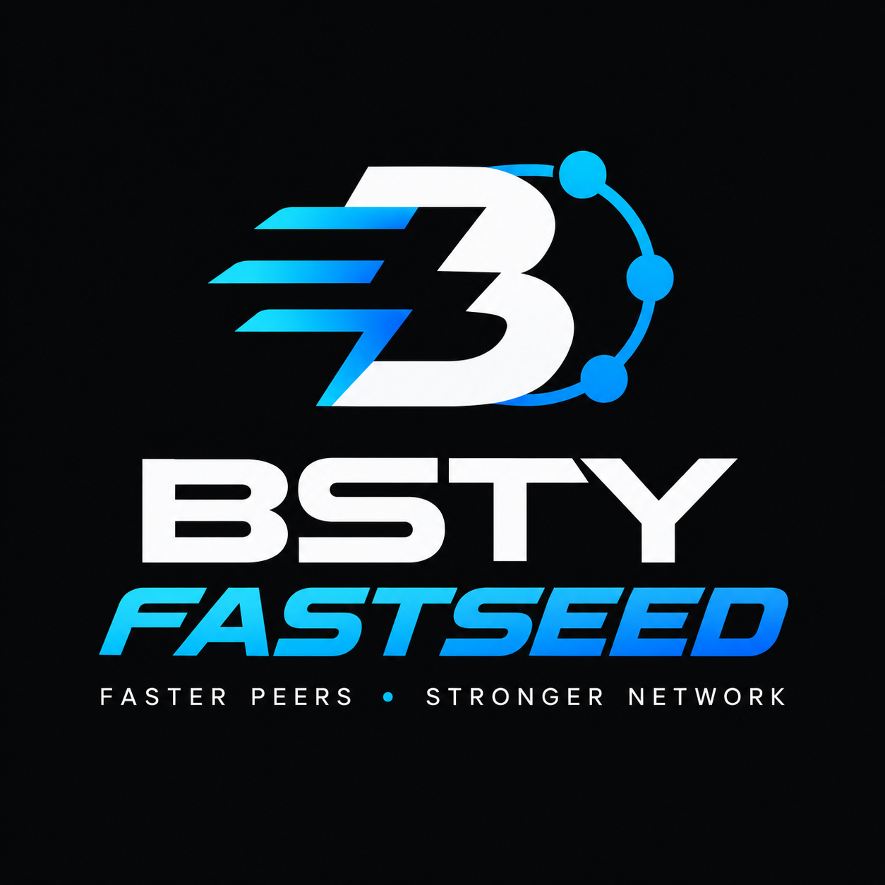

# BSTY-FastSeed 2.0.0-alpha2 — protocol codec

Development milestone Stage 14.2 builds on alpha1's core foundation. It adds
bounded serialization, canonical CompactSize, strict shared header validation,
incremental frame decoding and independent known-byte regression vectors.
The existing BSTY P2P protocol (70016 / port 8226) and DNS runtime are retained.

Read [the protocol contract](docs/ALPHA2-PROTOCOL.md),
[the roadmap](docs/V2-ROADMAP.md) and [verification results](release/V2-VERIFICATION.txt).
Mesh v2, signed identities, config v2 and persistence migration remain future work.
The new frame decoder is available for the session integration in Stage 14.4.

Use an isolated development deployment. Keep production seeders on v1.0.0 until
the new revision passes its own Ubuntu CI and integration gates. Existing config
and database schemas are retained. The legacy --self-test acknowledgement does
not run the comprehensive tests: use scripts/release-gate.sh and sanitizer-gate.sh.

Reboot recovery and live Tor/I2P connections: **NOT TESTED**.

## Historical v1.0.0 documentation

# BSTY-FastSeed v1.0.0

## Boost compatibility update — 2026-10-30

Four timer cancellation calls in probe, crawler and transport now use the
supported zero-argument cancel() API with system_error handling during cleanup.
Socket cancellation calls are unchanged. This addresses the Boost 1.90 build failure.

Operator-provided Ubuntu 26.04.1 LTS results (GCC 15.2.0 / Boost 1.90.0):
- Release CTest: 50/50 passed, 1.94 seconds.
- Federation/handshake repeated regression checks: passed, 24.56 seconds.
- Application smoke and full release gate: PASS.
- ASan/UBSan CTest: 50/50 passed, 13.14 seconds; full sanitizer gate: PASS.
- Nonfatal shared_ptr atomic deprecation and federation indentation warnings remain.

Earlier Ubuntu 22.04/GCC11 results cover the preceding runtime revision.
The timer-adjusted revision has not been retested on Ubuntu 22.04 here.
Ubuntu 24.04 full-suite validation remains pending.
Reboot recovery: NOT TESTED. Live Tor/I2P connections: NOT TESTED.
Transport component/mock tests do not establish live overlay connectivity.

Tests were run by the operator, not the packaging agent. The logs report version
1.0.0. The operator supplied no source/binary hash, so these are evidence for the
described changes, not a cryptographic attestation of this archive. Packaging
checks verify archive integrity; no new C++ build or deployment ran locally.


<p align="center">
  
</p>

Standalone GlobalBoost-Y peer discovery and authoritative DNS seeder. This final
source package consolidates the RC1 EasyDeploy baseline, DNS compatibility fixes,
release-gate corrections, and modern peer-handshake fixes developed and exercised
before the v1.0.0 final release. Intermediate packages were labeled v1.0.1 during
validation; they were not the final release numbering.

## Included functionality

- BSTY mainnet probing (port 8226, protocol 70016), peer health/cache and SQLite persistence.
- ADDRv2 discovery with IPv4/IPv6 and optional Tor v3/I2P transport components.
- Native authoritative UDP/TCP DNS with A/AAAA, NS/SOA, EDNS(0), BADVERS,
  bounded parsing, rate limits, negotiated UDP limits and correct truncation.
- Adaptive scheduling, feedback/confidence, intelligence, federation and metrics components.
- Correct pre-verack capability handling and owned asynchronous write buffers.

Not a full node: no blockchain synchronization, consensus, wallet or mining.
Only eligible, fresh IPv4/IPv6 peers are exposed through A/AAAA answers. Empty-cache
NOERROR/NODATA with SOA is expected until eligible peers are available.

## Build and verify (Ubuntu 22.04 and 26.04; see validation scope above)

```bash
sudo apt-get update
sudo apt-get install -y build-essential cmake libboost-dev libssl-dev libsqlite3-dev python3 dnsutils
python3 scripts/verify-source.py
bash scripts/release-gate.sh
```

The gate builds all targets, runs all 50 CTest suites with assertions active,
repeats the federation and handshake suites 20 times each, checks version/configs,
and performs independent wire-decoder and dig checks. It does not install or
restart the service. Logs: `verification-results/release.log`.

```bash
bash scripts/sanitizer-gate.sh
```

This builds and runs the complete suite with ASan/UBSan and leak detection.
Logs: `verification-results/sanitizers.log`. Do not install sanitizer binaries.
Compatibility aliases `verify-gatefix.sh` and `rc-gate.sh` invoke the final release gate.

## Deploy or upgrade

Read [deployment instructions](docs/DEPLOYMENT.md) before changing a live service.
Fresh-install example (after the release gate passes):

```bash
sudo bash deploy-fastseed.sh seeder.globalboost.info nsseed.globalboost.info
```

The helper refuses an existing configuration or an occupied port 53. Existing
installations should follow the documented upgrade/rollback procedure, preserving
configuration and database. There is no need to reboot the server to install.

Publish the parent NS delegation and a stable nameserver A record. For the example,
`nsseed.globalboost.info` must resolve to the DNS host, and `seeder.globalboost.info`
must be delegated to it. An A record alone is not delegation.

## Commands

```bash
./build-release/bsty-fastseed --version
./build-release/bsty-fastseed --help
./build-release/bsty-fastseed --check-config config/fastseed.production.toml
./build-release/bsty-fastseed probe 69.197.161.154:8226
./build-release/bsty-fastseed run --config /etc/bsty-fastseed/fastseed.toml
```

`--self-test` is a legacy CLI acknowledgment; the release gate, CTest and independent
smoke checks are the actual validation. Probe status 0 means success. A standalone
probe does not populate the running service's cache.

## Verification and limits

The operator supplied logs showing 50/50 normal tests, 50/50 sanitizer tests,
20 repeats each of federation/handshake tests, independent DNS smoke checks,
working public UDP/TCP and recursive resolution, successful live BSTY handshakes,
and a 144-sample overnight run. Original evidence is bundled under
`release/evidence/`. See [verified results](release/VERIFIED-RESULTS.txt) for exact
scope and provenance. Evidence logs retain their original intermediate version.

**Reboot recovery was not tested.** Service restart and enabled startup were
observed; they do not establish full-server reboot recovery.

The final version identifiers, release scripts and documents were consolidated
after those runs. Local Ubuntu execution is blocked, so a fresh compile/test of
the exact final-labeled package has not been run here. Run the included gates on
the target host. No prebuilt executable is included.

See [configuration](docs/CONFIGURATION.md), [changelog](CHANGELOG.md),
[release notes](release/RELEASE-NOTES.md), and historical phase documents in docs/.
